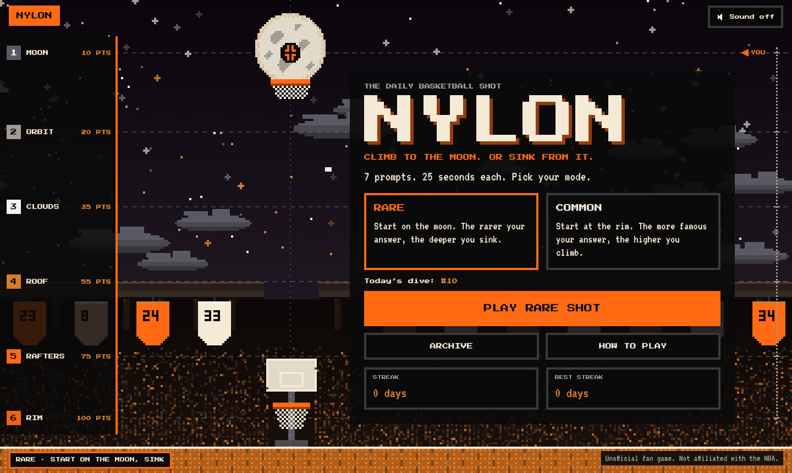
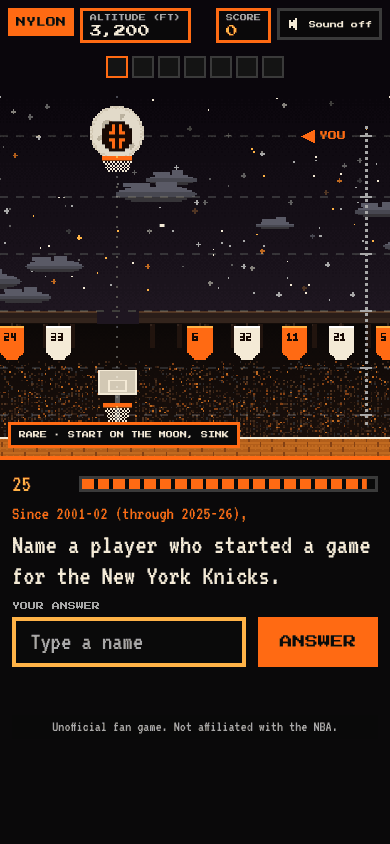
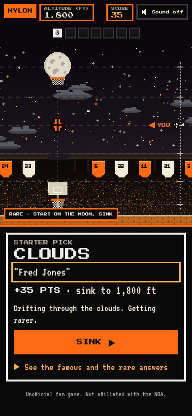
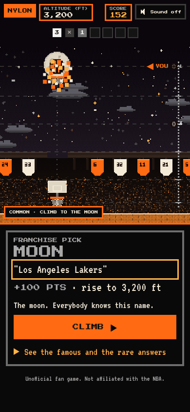
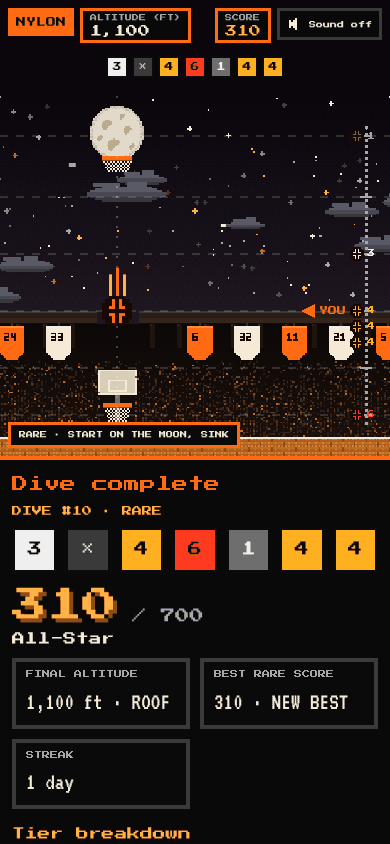

# NYLON

**NYLON** is a daily basketball shot. Every day there is a new **dive** of seven prompts, 25 seconds each, for example "Since 2001-02, name a player who played for both the Philadelphia 76ers and the Phoenix Suns". Name any valid answer and the ball moves: in **RARE** mode the ball starts on the moon and the rarer your answer, the deeper it sinks (and the more you score); in **COMMON** mode it starts at the rim and the more famous your answer, the higher it climbs. Share your total and seven coloured squares.

It is a static website (Vite, React, TypeScript) with no backend, no accounts, no analytics and no cookies. The prompts come from an offline Python pipeline that turns real NBA box scores (2001-02 to 2025-26) into two JSON files. (The game was called Deep Cut until session 7f; the repository and the address are unchanged.)



| Phone: a prompt | Phone: an answer lands | Phone: the end level | Phone: results |
| --- | --- | --- | --- |
|  |  |  |  |

The whole screen is one pixel-art **moon world**, drawn in code: a night sky with the moon (and a hoop on it), clouds, an arena roof with banners, a crowd and a hardwood floor with a hoop. The ball moves up and down a column through six levels (moon, orbit, clouds, roof, rafters, rim) and a card floats at the right with the question. On a phone the card is a sheet at the bottom. More screenshots at three sizes are in [docs/screenshots/nylon](docs/screenshots/nylon); [docs/design.md](docs/design.md) explains the design.

## How it plays

- **A dive** is 7 prompts, 25 seconds each, the same seven for everyone each day (the day changes at midnight in New York). Type a name (autocomplete suggests from the whole list of players and teams, so it never gives an answer away) and press Enter.
- **Two modes**, chosen on the home screen, remembered, and shown in the address (`#rare`, `#common`). Every valid answer has a fame tier (1 = most famous, 6 = rarest) and the mode decides what it is worth: RARE pays 10, 20, 35, 55, 75, 100 for tiers 1 to 6; COMMON pays 100, 75, 55, 35, 20, 10. A wrong, empty or late answer is an airball: 0 points in both modes, and the ball stays where it is. A dive is worth at most 700.
- **The result card** shows the level the ball landed on (and its pick: FRANCHISE, ALL-STAR, STARTER, ROTATION, BENCH, DEEP CUT), your answer, the points, the new altitude and a line about it. Enter or the button goes on. Reaching the end level (the moon in COMMON, the rim in RARE) sets off a small celebration.
- **Streaks and the archive:** a day counts for your streak if you finish either mode. Finished dives, best scores and the archive are kept per mode, in your browser (localStorage); there is no account. What the game saved under its old name (Deep Cut) is copied to the new `nylon:*` keys the first time it runs, so nothing is lost.
- A real player from before 2001-02 gets an "outside the data range" message, not a miss.

## Run it

You need Node 20.19 or later (Node 22 works too).

```
cd web
npm install        # or npm ci
npm run dev        # http://localhost:5173
```

`npm run dev` first copies the pipeline's export into `web/public/` when `data/export/` exists (and says so when it does not). The three data files are committed in `web/public/`, so the site also runs from `web/` alone.

Other commands, all in `web/`:

| Command | What it does |
| --- | --- |
| `npm test` | the unit and integration tests (Vitest) |
| `npm run build` | type-check and build to `web/dist` |
| `npm run preview` | serve the production build locally |
| `npm run sync-data` | copy `data/export/*.json` and the outside-range list into `web/public/` |

Useful URLs while developing: `/?preview=1` shows a Play-test before launch, `/?preview=1&today=2026-11-10` pretends it is that day (with its own saved progress), and `/?animations=1` (development) or `/?preview=1&animations=1` (a build) shows the ball moving to every level in either mode, on a loop or one at a time. Add `#common` to any address to open in COMMON mode.

## Regenerate the data

The data pipeline needs Python 3 with pandas and pyarrow, and a network connection for the first download. From the repository root:

```
pip install -r pipeline/requirements.txt
python3 pipeline/run.py        # download and normalize box scores into data/processed/ (about 90 s)
python3 pipeline/export.py     # fame scores, candidates, 504 curated prompts, universe, checks (about 2 minutes)
cd web && npm run sync-data    # copy the export into web/public/, then commit it
cd ../pipeline && python3 -m pytest
```

`export.py` writes `data/export/prompts.json` (504 prompts, 72 dives of 7), `data/export/universe.json` (every player and team with aliases) and reports in `docs/`: [curation-report.md](docs/curation-report.md), [rarity-report.md](docs/rarity-report.md), [prompts-sample.md](docs/prompts-sample.md), [fame-report.md](docs/fame-report.md) and [prompt-candidates.md](docs/prompt-candidates.md). The file layout is in [docs/export-format.md](docs/export-format.md).

## Scoring and rarity

Rarity is **an approximation**. A static site cannot count what other players typed, so each player's fame is estimated from the data: the best rank across career points, rebounds, assists, steals plus blocks and best season points per game, turned into a percentile over every player in the data. The top 3% are tier 1 (10 points), then 3 to 10% (20), 10 to 25% (35), 25 to 50% (55), 50 to 75% (75) and the rest tier 6 (100). A few players whose careers started before 2001-02 have hand-set tiers (`pipeline/data/fame_overrides.csv`). Teams are tier 1 under their current name and tier 4 only under a historical one. The how-to-play screen says all of this in one line. Details and known oddities: [docs/fame-report.md](docs/fame-report.md).

Every prompt states its era, "Since 2001-02 (through 2025-26)", and its valid answers are computed from the games, not written by hand.

## Daily rotation and the launch date

Dive number = days since the launch date + 1, counted on the calendar in **America/New_York**, so everyone gets the same dive and it changes at midnight New York time. Dive N plays prompts 7(N-1) to 7(N-1)+6 of `prompts.json`, and the file starts again after its last dive (every 72 days). The launch date, time zone and site address are constants in [`web/src/config.ts`](web/src/config.ts): `LAUNCH_DATE` is `2026-10-29` (dive #1), and before it the site shows a "Coming soon" screen (`?preview=1` still lets a tester in). `SITE_URL` is `https://nba-deep-cut.vercel.app`; it goes into the share line and the social tags.

## Deploy

Vercel steps and a launch checklist are in [docs/deploy.md](docs/deploy.md).

## Repository map

- `web/` the site (React, TypeScript, Vite); `web/public/` holds the committed data files
- `pipeline/` the Python pipeline, with its tests
- `schema/` JSON schemas for the two data files, and the name-matching cases shared by the site and the pipeline
- `data/export/` the pipeline's output; `data/raw` and `data/processed` are local and gitignored
- `docs/` reports, notes and the deploy guide; [SPEC.md](SPEC.md) is the original plan and [CLAUDE.md](CLAUDE.md) holds the rules and commands for working on the repo with Claude Code

No NBA logos or league branding are used; teams and players appear by plain name only.
